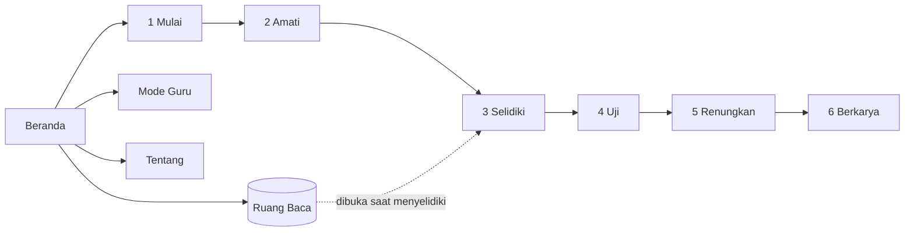

# PRD — Neraca Warga

**Media Ajar Interaktif Pendidikan Pancasila Kelas IX**
Bab 2 Hak dan Kewajiban Warga Negara · Subbab D *Tantangan Pemenuhan Hak dan Kewajiban Warga Negara*

| Butir | Isi |
| --- | --- |
| Dokumen | Product Requirements Document (PRD) |
| Versi | 0.1 (draf Gerbang 0, menunggu persetujuan) |
| Tanggal | 23 November 2026 |
| Pemilik produk | I Wayan Gede Griyawana (YAN) |
| Sumber konten | Modul Ajar Pendidikan Pancasila Kelas IX: Tantangan Pemenuhan Hak dan Kewajiban Warga Negara (Revisi) |
| Nama situs | **Neraca Warga** (nama kerja; lihat Keputusan Terbuka K-01) |
| Dokumen terkait | 02-SPESIFIKASI-KONTEN · 03-DESAIN-INTERAKSI · 04-SPESIFIKASI-TEKNIS · 05-RENCANA-KERJA · 06-RENCANA-UJI · 07-PROMPT-AGEN |

---

## 1. Ringkasan

Neraca Warga adalah website media ajar yang mengubah modul ajar subbab *Tantangan Pemenuhan Hak dan Kewajiban Warga Negara* menjadi pengalaman belajar interaktif. Situs ini melayani dua pemakai sekaligus: **peserta didik kelas IX** yang belajar lewat gawai, dan **guru** yang memimpin pembelajaran 3 JP (120 menit) di depan kelas.

Alurnya mengikuti sintaks *Problem Based Learning* (PBL) pada modul, dibagi menjadi enam stasiun:

> **1 Mulai → 2 Amati → 3 Selidiki → 4 Uji → 5 Renungkan → 6 Berkarya**

Bahan bacaan modul (Lampiran 2) hadir sebagai **Ruang Baca** yang bisa dibuka kapan saja, terutama saat siswa menyelidiki kasus.

Metafora utamanya adalah **neraca (timbangan)**. Pesan inti modul, yaitu *hak dan kewajiban harus dilaksanakan secara seimbang*, diwujudkan sebagai interaksi kecil yang berulang di seluruh situs. Situs ini ringan, bisa dipasang seperti aplikasi, tetap jalan tanpa internet setelah kunjungan pertama, tanpa akun, dan tanpa pelacakan.

## 2. Latar belakang dan masalah

1. **Bahan ajar tersebar.** Modul memakai PPT, video YouTube, LKPD kertas, bahan bacaan, Quizizz/Wayground, dan kertas tempel. Guru harus berpindah-pindah alat. Website menyatukan semuanya dalam satu alur.
2. **Kebutuhan diferensiasi.** Modul menetapkan tiga profil siswa (perlu pendampingan, reguler, berpencapaian tinggi). Pertanyaan penuntun bertahap, materi multimodal, dan pilihan bentuk produk paling mudah diberikan secara digital.
3. **Prinsip pembelajaran mendalam.** Kegiatan modul diberi label *berkesadaran*, *bermakna*, dan *menggembirakan*. Bacaan statis saja tidak cukup *menggembirakan*. Perlu interaksi kecil yang bermakna, bukan hiasan.
4. **Keterbatasan perangkat dan jaringan.** Gawai siswa beragam, kuota terbatas, dan internet sekolah tidak selalu stabil. Sebagian siswa tidak punya gawai, sehingga modul menyediakan lembar cetak. Situs harus ringan, bisa luring, dan punya versi cetak.
5. **Topik sensitif.** Perundungan dan kekerasan di sekolah menyentuh pengalaman pribadi. Modul menegaskan bahwa siswa **tidak diminta menceritakan pengalaman pribadi sebagai korban di depan kelas**. Situs harus mewarisi kehati-hatian ini.

## 3. Tujuan dan indikator keberhasilan

### 3.1 Tujuan pembelajaran yang didukung (dari modul)

- **TP 1.** Peserta didik mampu menganalisis permasalahan pemenuhan hak dan kewajiban warga negara di Indonesia beserta pasal UUD NRI Tahun 1945 yang terkait melalui diskusi kasus secara berkelompok dengan cermat.
- **TP 2.** Peserta didik mampu merumuskan minimal dua upaya yang logis untuk menghormati hak dan kewajiban warga negara secara seimbang, termasuk dukungan terhadap penegakan hukum, melalui diskusi kelompok.

### 3.2 Tujuan produk

| ID | Tujuan | Indikator terukur |
| --- | --- | --- |
| G-1 | Siswa dapat menganalisis kasus secara digital | ≥ 80% siswa uji coba menyelesaikan satu LKPD digital (5 langkah analisis) dalam ±25 menit di HP tanpa bantuan teknis |
| G-2 | Siswa mendapat umpan balik langsung | Setiap permainan dan soal kuis memberi umpan balik + alasan dalam < 100 md setelah dipilih (INP ≤ 200 md) |
| G-3 | Guru dapat menjalankan alur 120 menit | Mode Guru mencakup semua segmen waktu modul (15/85/20 menit) dan dapat dioperasikan dengan keyboard/klik di proyektor |
| G-4 | Ringan dan tahan luring | Lighthouse seluler ≥ 90 (Performance, Accessibility, Best Practices); LCP ≤ 2,5 dtk, CLS ≤ 0,1; semua halaman terbuka dalam mode pesawat setelah kunjungan pertama |
| G-5 | Aksesibel | Sesuai WCAG 2.2 AA; axe-core: 0 pelanggaran *serious/critical*; seluruh fungsi bisa dipakai dengan keyboard dan pembaca layar |
| G-6 | Setia pada modul | 100% butir pada *Checklist Keselarasan* (02-SPESIFIKASI-KONTEN §14) tercentang; semua rujukan pasal baru diverifikasi YAN |
| G-7 | Dibangun dengan praktik web modern | Setiap fitur melewati alur *Modern Web Guidance* dan laporan serah terima memuat bagian `### Modern Web Guidance` |
| G-8 | Disukai siswa | Angket kepraktisan uji coba terbatas: rata-rata ≥ 3,0 dari skala 4 |

## 4. Pengguna

### 4.1 Kelompok pengguna

| Kelompok | Peran | Kebutuhan utama |
| --- | --- | --- |
| Peserta didik kelas IX (±14–15 tahun) | Pengguna utama | Bahasa ramah, langkah jelas, umpan balik cepat, bisa di HP, tidak menghakimi |
| Guru Pendidikan Pancasila (termasuk YAN saat praktik mengajar) | Pengguna utama kedua | Alur waktu, timer, tampilan proyektor, rubrik, kalkulator nilai, versi cetak |
| Dosen/penilai media | Pengguna sekunder | Melihat keselarasan dengan modul, kualitas media, identitas pengembang |

### 4.2 Persona

- **Putu (siswa reguler).** HP Android RAM 3 GB, kuota terbatas, lebih cepat paham lewat gambar dan video. Ia butuh halaman yang cepat dimuat dan tidak boros kuota.
- **Ayu (perlu pendampingan).** Membaca pelan dan ragu saat mengaitkan kasus dengan pasal. Ia butuh pertanyaan penuntun yang muncul satu per satu dan tabel ringkas Pasal 28A–28J.
- **Komang (berpencapaian tinggi).** Cepat selesai dan suka tantangan. Ia butuh pengayaan: UU Nomor 39 Tahun 1999, berita penegakan hukum, dan video pengayaan Buku Siswa.
- **Bu Sari (guru).** Laptop + proyektor, 4 kelompok, 120 menit. Ia butuh timer per segmen, tampilan besar untuk *ice breaking*, rubrik, dan penghitung nilai TP.

## 5. Konteks pemakaian

| Skenario | Gambaran | Implikasi desain |
| --- | --- | --- |
| A. Kelas tatap muka | Guru memimpin dengan proyektor; siswa berkelompok memakai HP | Mode Guru berhuruf besar; LKPD digital per kelompok; versi cetak |
| B. Belajar mandiri | Siswa di rumah dengan HP sendiri, kadang tanpa internet | Alur linear yang jelas; progres tersimpan di perangkat; luring |
| C. Perangkat bersama | Lab komputer dipakai bergantian | Nama tidak pernah disimpan; tombol **Hapus data di perangkat ini** mudah ditemukan |
| D. Tanpa gawai | Sebagian siswa tidak punya HP | LKPD kosong dan soal kuis dapat dicetak dari situs |

## 6. Keselarasan dengan modul

### 6.1 Komponen modul → fitur website

| Komponen modul | Wujud di website | Halaman |
| --- | --- | --- |
| Identitas, CP, TP, dimensi profil lulusan, pendekatan/model/metode | Halaman Tentang + ringkasan TP ramah siswa | `tentang.html`, `mulai.html` |
| Emoticon perasaan (KSE) | Cek Perasaan (tidak disimpan) | `mulai.html` |
| *Ice breaking* "Hak atau Kewajiban?" (tangan kanan = hak, kiri = kewajiban, keduanya = keduanya) | Permainan kartu dengan tombol kiri/tengah/kanan + neraca; versi proyektor | `mulai.html`, `guru.html` |
| Pertanyaan pemantik | Tiga pertanyaan + catatan pribadi opsional + catatan keselamatan | `mulai.html` |
| Orientasi masalah: grafik JPPI, Gambar 2.9, video YouTube | Grafik interaktif "Tebak dulu!", rujukan halaman Buku Siswa, video dengan fasad | `amati.html` |
| Data PISA 2018 | Grafik batang + catatan cara membaca proporsi | `amati.html` |
| LKPD 1–4 | LKPD digital bertahap, penuntun, pemilih pasal, ringkasan cetak | `selidiki.html`, `kasus-1…4.html` |
| Bahan bacaan (Lampiran 2) | Ruang Baca 4 bagian + interaksi (Kartu Masalah, Pasangan Seimbang, Peta Pasal, Pohon Peradilan, Siapa yang Menangani?) | `ruang-baca.html`, `baca-*.html` |
| Poster gagasan solutif | Kerangka poster (templat isi) | `kasus-*.html` |
| Evaluasi proses pemecahan masalah | Ceklis evaluasi kelompok | `kasus-*.html` |
| Post-test 10 soal | Kuis latihan dengan pembahasan dan skor per TP | `uji.html` |
| Teknik STOP | Panduan napas terpandu | `renungkan.html` |
| Refleksi 4P + bagian yang sulit | Refleksi a–e + Catatan Tempel | `renungkan.html` |
| Tugas produk kampanye antiperundungan | Halaman tugas, kriteria, bank data & pasal dengan tombol salin | `berkarya.html` |
| Asesmen, rubrik, KKTP, remedial, pengayaan | Mode Guru: rubrik, kalkulator nilai TP, predikat sikap, tindak lanjut | `guru-penilaian.html` |
| Diferensiasi konten/proses/produk | Penuntun bertahap, multimodal, pengayaan, pilihan bentuk produk | Semua stasiun |
| Glosarium | Halaman glosarium + istilah bertitik di teks | `glosarium.html` + semua halaman bacaan |
| Daftar pustaka | Daftar sumber | `tentang.html` |

### 6.2 Sintaks PBL dan prinsip pembelajaran mendalam

| Sintaks PBL (modul) | Stasiun | Prinsip yang ditandai | Pengalaman belajar |
| --- | --- | --- | --- |
| Pendahuluan (salam, KSE, *ice breaking*, apersepsi, TP, pemantik) | 1 Mulai | Berkesadaran, Menggembirakan | Memahami |
| 1. Orientasi peserta didik pada masalah | 2 Amati | Berkesadaran | Memahami |
| 2. Mengorganisasikan peserta didik untuk belajar | 3 Selidiki (pilih kasus & peran) | — | Mengaplikasi |
| 3. Membimbing penyelidikan individu dan kelompok | 3 Selidiki (+ Ruang Baca) | Bermakna | Mengaplikasi |
| 4. Mengembangkan dan menyajikan hasil karya | 3 Selidiki (poster), Mode Guru (presentasi) | Bermakna, Menggembirakan | Mengaplikasi |
| 5. Menganalisis dan mengevaluasi proses | 3 Selidiki (evaluasi), Mode Guru (umpan balik) | Berkesadaran | Merefleksi |
| Penutup: simpulan, STOP, post-test | 4 Uji, 5 Renungkan | Berkesadaran, Menggembirakan | Merefleksi |
| Penutup: refleksi 4P, kertas tempel | 5 Renungkan | Berkesadaran | Merefleksi |
| Penutup: tugas produk kampanye | 6 Berkarya | Bermakna | Mengaplikasi |

**Alasan Ruang Baca tidak menjadi stasiun wajib sebelum Selidiki.** Dalam PBL, masalah datang lebih dulu dan mendorong siswa mencari konsep. Karena itu Ruang Baca berfungsi sebagai sumber yang ditautkan dari setiap langkah LKPD (misalnya "Buka Peta Pasal 28A–28J"). Siswa yang perlu pendampingan tetap disarankan membuka Ruang Baca lebih dulu, sesuai diferensiasi konten pada modul.

Label prinsip (*Berkesadaran/Bermakna/Menggembirakan*) tampil sebagai *chip* kecil di kepala setiap stasiun dan di Mode Guru, supaya keselarasan dengan modul terlihat oleh guru dan penilai.

## 7. Ruang lingkup versi 1.0

Prioritas: **P0** = wajib ada saat rilis, **P1** = sebaiknya ada, **P2** = bila waktu cukup.

| Termasuk | Prioritas |
| --- | --- |
| Beranda, enam stasiun, Ruang Baca 4 bagian, Glosarium, Tentang (+ privasi) | P0 |
| Permainan Hak atau Kewajiban?, grafik JPPI "Tebak dulu!", Pasangan Seimbang, Peta Pasal, LKPD digital 1–4, Kuis 10 soal, Refleksi 4P | P0 |
| Progres tersimpan di perangkat, hapus data, mode gelap otomatis, luring (service worker), versi cetak LKPD | P0 |
| Mode Guru (alur & timer, *ice breaking* proyektor, rubrik, kalkulator KKTP, versi cetak) | P1 |
| Berkarya (tugas + bank data salin), Siapa yang Menangani?, Pohon Peradilan, grafik PISA, Kartu Masalah, STOP napas, lencana, transisi halaman, tombol pasang aplikasi, popover glosarium, sakelar tema 3 status | P1 |
| Roda giliran presentasi, gestur geser/seret sebagai alternatif ketuk, suara (bawaan mati) | P2 |

**Tidak termasuk versi 1.0:** akun/login, server/basis data, papan skor atau permainan *real-time* (ranah mode Jejak Setara di Ruang Setara), chatbot AI, unggah berkas, analitik/pelacakan, multibahasa, pengiriman jawaban ke guru secara daring.

## 8. Arsitektur informasi

### 8.1 Peta situs

```text
index.html               Beranda
├─ mulai.html            1 Mulai: cek perasaan, Hak atau Kewajiban?, TP, pemantik
├─ amati.html            2 Amati: grafik JPPI, video, data PISA, tanggapan awal
├─ selidiki.html         3 Selidiki: pilih kasus & peran
│  ├─ kasus-1.html       LKPD 1 Kebebasan Berekspresi di Media Sosial
│  ├─ kasus-2.html       LKPD 2 Perundungan dan Tawuran Pelajar
│  ├─ kasus-3.html       LKPD 3 Pelanggaran Lalu Lintas oleh Pelajar
│  └─ kasus-4.html       LKPD 4 Alih Fungsi Hutan Lindung
├─ uji.html              4 Uji: kuis 10 soal
├─ renungkan.html        5 Renungkan: simpulan, STOP, refleksi 4P
├─ berkarya.html         6 Berkarya: tugas kampanye antiperundungan
├─ ruang-baca.html       Ruang Baca (Lampiran 2)
│  ├─ baca-permasalahan.html
│  ├─ baca-upaya.html
│  ├─ baca-ham.html
│  └─ baca-penegakan-hukum.html
├─ glosarium.html
├─ guru.html             Mode Guru: alur & timer, ice breaking, pemantik, kelompok
├─ guru-penilaian.html   Mode Guru: rubrik, kalkulator nilai TP, rambu jawaban, cetak
├─ tentang.html          Identitas modul, kredit, sumber, privasi
├─ offline.html
└─ 404.html
```

### 8.2 Alur belajar



### 8.3 Navigasi

- **Kepala halaman ringkas** (< 12% tinggi layar): logo Neraca Warga, tautan Jalur Belajar, Ruang Baca, Glosarium, dan tombol Menu (Mode Guru, Tentang, Pengaturan tema, Hapus data).
- **Penanda stasiun**: "Stasiun 3 dari 6" + titik progres.
- **Bilah bawah** di layar sempit: tombol *Sebelumnya* dan *Berikutnya* sepanjang jalur, aman dari area sistem (*safe area*).
- **Beranda** menampilkan kartu enam stasiun dengan status *Belum mulai / Sedang / Selesai* dan tombol *Lanjutkan* ke stasiun terakhir.

## 9. Kebutuhan fungsional

Kriteria terima rinci ada di 05-RENCANA-KERJA dan 06-RENCANA-UJI. Isi konten ada di 02-SPESIFIKASI-KONTEN.

### 9.1 Global

| ID | Kebutuhan | P |
| --- | --- | --- |
| FR-01 | Navigasi jalur (sebelumnya/berikutnya), penanda stasiun, tautan lewati ke konten utama | P0 |
| FR-02 | Progres per stasiun dan per bagian Ruang Baca disimpan di perangkat (localStorage), tanpa nama siswa | P0 |
| FR-03 | Tombol **Hapus data di perangkat ini** di Beranda, Menu, dan Tentang, dengan dialog konfirmasi | P0 |
| FR-04 | Tema terang/gelap mengikuti sistem; sakelar 3 status (Otomatis/Terang/Gelap) | P0 otomatis · P1 sakelar |
| FR-05 | Situs bekerja luring setelah kunjungan pertama; halaman `offline.html` sebagai cadangan | P0 |
| FR-06 | Tombol pasang aplikasi hanya muncul bila peramban mendukung | P1 |
| FR-07 | Kotak **Butuh bantuan?** (guru/guru BK, orang tua, SAPA 129) di Mulai, Amati, LKPD 1–2, Renungkan, Tentang | P0 |
| FR-08 | Lencana per stasiun dan lencana akhir *Warga Seimbang* | P1 |
| FR-09 | Istilah glosarium bertitik di teks membuka definisi singkat | P1 |
| FR-10 | Gaya cetak untuk LKPD (kosong & terisi), soal kuis, rubrik | P0 LKPD · P1 lainnya |

### 9.2 Beranda (`index.html`)

| ID | Kebutuhan | P |
| --- | --- | --- |
| FR-11 | Judul, tagline, ilustrasi neraca interaktif, tombol *Mulai Belajar* atau *Lanjutkan: [stasiun]* | P0 |
| FR-12 | Kartu enam stasiun + kartu Ruang Baca dengan status progres | P0 |
| FR-13 | Pilihan *Saya siswa* (jalur) dan *Saya guru* (Mode Guru), tanpa login | P0 |
| FR-14 | Catatan privasi satu kalimat + tautan ke Tentang | P0 |

### 9.3 Stasiun 1 — Mulai (`mulai.html`)

| ID | Kebutuhan | P |
| --- | --- | --- |
| FR-20 | Cek Perasaan: 6 emoticon, respons suportif, **tidak disimpan** | P0 |
| FR-21 | Permainan *Hak atau Kewajiban?*: 14 pernyataan; tombol **Kewajiban** (kiri), **Keduanya** (tengah), **Hak** (kanan) sesuai aturan tangan pada modul; umpan balik + dasar pasal; skor; neraca seimbang di akhir; main lagi dengan urutan acak | P0 |
| FR-22 | TP 1 dan TP 2 dalam bahasa ramah siswa + "Yang akan kamu lakukan hari ini" | P0 |
| FR-23 | Tiga pertanyaan pemantik + catatan pribadi opsional (disimpan di perangkat) + catatan keselamatan | P0 |

### 9.4 Stasiun 2 — Amati (`amati.html`)

| ID | Kebutuhan | P |
| --- | --- | --- |
| FR-30 | Grafik kasus kekerasan di satuan pendidikan 2020–2025 (JPPI): tebak angka 2025 dengan *slider*, lalu ungkap; catatan bahwa data mencakup seluruh kekerasan, bukan hanya perundungan; sumber; tabel data alternatif | P0 |
| FR-31 | Video materi (YouTube) lewat fasad klik-untuk-memuat (domain *nocookie*) + ringkasan teks video + pesan saat luring | P0 |
| FR-32 | Tanggapan awal: pilih hak yang terganggu dan kewajiban yang diabaikan (*chip*) + teks bebas; disimpan di perangkat | P0 |
| FR-33 | Grafik bentuk perundungan PISA 2018 + catatan "proporsi antarbentuk, bukan persentase siswa" | P1 |
| FR-34 | Rujukan Gambar 2.9 Kampanye Antiperundungan (Buku Siswa hlm. 50) sebagai tautan/keterangan, **tanpa menyalin gambar buku** | P0 |

### 9.5 Ruang Baca (`ruang-baca.html`, `baca-*.html`)

| ID | Kebutuhan | P |
| --- | --- | --- |
| FR-40 | Hub empat bagian dengan estimasi waktu baca dan status *Sudah dibaca* | P0 |
| FR-41 | Bagian 1 Permasalahan: teks modul + kotak Fakta Terkini + Kartu Masalah (a–d) yang menautkan ke LKPD terkait | P0 teks · P1 kartu |
| FR-42 | Bagian 2 Upaya: definisi hak/kewajiban, contoh, permainan **Pasangan Seimbang** (7 pasangan) | P0 |
| FR-43 | Bagian 3 HAM: teks modul, kutipan UU 39/1999, **Peta Pasal** 28A–28J + pasal 27, 30, 31 dengan pencarian | P0 |
| FR-44 | Bagian 4 Penegakan Hukum: kartu lembaga & aparat, **Pohon Peradilan**, permainan **Siapa yang Menangani?** | P0 teks · P1 interaksi |
| FR-45 | Tombol *Tandai sudah dibaca* di akhir setiap bagian; indikator progres baca | P0 tombol · P1 indikator |
| FR-46 | Kotak pengayaan untuk siswa berpencapaian tinggi (UU 39/1999, berita penegakan hukum, video pengayaan) | P1 |

### 9.6 Stasiun 3 — Selidiki (`selidiki.html`, `kasus-*.html`)

| ID | Kebutuhan | P |
| --- | --- | --- |
| FR-50 | Pilih kasus (4 kartu) + penjelasan peran ketua, notulis, penyaji, pencari informasi | P0 |
| FR-51 | LKPD bertahap: Baca Kasus → P1 (hak terganggu, kewajiban diabaikan, pasal) → P2 (dampak per pihak) → P3 (minimal dua upaya) → Kerangka Poster → Evaluasi Proses → Ringkasan | P0 |
| FR-52 | Tombol *Butuh petunjuk?* membuka pertanyaan penuntun satu per satu | P0 |
| FR-53 | Pemilih pasal berupa *chip* dengan info singkat; tautan ke Peta Pasal | P0 |
| FR-54 | Simpan otomatis di perangkat + status "Tersimpan"; dapat dilanjutkan | P0 |
| FR-55 | Cek Mandiri sebelum ringkasan, diturunkan dari rubrik keterampilan indikator 1–3 | P0 |
| FR-56 | Ringkasan siap cetak/simpan PDF dan salin teks; isian kelompok/kelas/nama anggota **hanya untuk cetak, tidak disimpan** | P0 |
| FR-57 | Timer diskusi opsional 25 menit + timer poster 10 menit | P1 |

### 9.7 Stasiun 4 — Uji (`uji.html`)

| ID | Kebutuhan | P |
| --- | --- | --- |
| FR-60 | 10 soal pilihan ganda Lampiran 3, satu per layar, umpan balik langsung + pembahasan | P0 |
| FR-61 | Hasil: nilai total (10/butir), nilai kuis per TP (20/butir; butir 1–5 = TP 1, 6–10 = TP 2), rekomendasi bagian Ruang Baca yang perlu diulang. **Tidak** memberi label "mencapai KKTP" karena KKTP butuh nilai rubrik | P0 |
| FR-62 | Ulangi kuis; nilai terbaik disimpan di perangkat | P0 |
| FR-63 | Keterangan: kuis ini latihan; post-test resmi mengikuti keputusan guru (Quizizz/Wayground atau lembar cetak) | P0 |

### 9.8 Stasiun 5 — Renungkan (`renungkan.html`)

| ID | Kebutuhan | P |
| --- | --- | --- |
| FR-70 | Simpulan pembelajaran (dari penutup modul) | P0 |
| FR-71 | Teknik STOP terpandu (napas), mulai hanya setelah diklik, bisa dijeda | P1 |
| FR-72 | Refleksi 4P (a–d) + pertanyaan e sebagai Catatan Tempel; bisa disalin/dicetak | P0 |

### 9.9 Stasiun 6 — Berkarya (`berkarya.html`)

| ID | Kebutuhan | P |
| --- | --- | --- |
| FR-80 | Tugas produk kampanye antiperundungan: pilihan bentuk (poster, pamflet/tulisan, video pendek), kriteria rubrik, tenggat, rujukan Buku Siswa hlm. 58–59 | P1 |
| FR-81 | Bank data & pasal dengan tombol salin | P1 |
| FR-82 | Ceklis rencana karya (disimpan di perangkat) | P1 |

### 9.10 Glosarium (`glosarium.html`)

| ID | Kebutuhan | P |
| --- | --- | --- |
| FR-90 | 19 istilah modul, kolom pencarian, jangkar per istilah | P0 |

### 9.11 Mode Guru (`guru.html`, `guru-penilaian.html`)

| ID | Kebutuhan | P |
| --- | --- | --- |
| FR-100 | Alur 120 menit per segmen dengan timer besar (mulai/jeda/ulang/lanjut) dan label prinsip | P1 |
| FR-101 | *Ice breaking* mode proyektor: tampilkan pernyataan, siswa angkat tangan, guru ungkap jawaban | P1 |
| FR-102 | Tampilan pertanyaan pemantik dan pembagian kelompok–LKPD–peran | P1 |
| FR-103 | Roda giliran presentasi 4 kelompok | P2 |
| FR-104 | Rubrik sikap dan keterampilan (lihat & cetak) | P1 |
| FR-105 | Kalkulator nilai TP sesuai rumus KKTP modul + predikat sikap + saran tindak lanjut; **tidak menyimpan data apa pun** | P1 |
| FR-106 | Rambu jawaban LKPD (setelah diverifikasi YAN) | P1 |
| FR-107 | Versi cetak: LKPD kosong 1–4 dan soal post-test untuk siswa tanpa gawai | P1 |

### 9.12 Tentang (`tentang.html`)

| ID | Kebutuhan | P |
| --- | --- | --- |
| FR-110 | Identitas modul, CP, TP, dimensi profil lulusan, pendekatan/model/metode, pengembang, daftar pustaka, lisensi aset, catatan privasi, versi situs | P0 |

## 10. Interaksi kecil (ringkasan)

Situs harus terasa hidup tanpa melelahkan. Setiap interaksi kecil wajib **bermakna** (memperkuat konsep), **cepat** (umpan balik seketika), **dapat dipakai tanpa mouse**, dan **menghormati preferensi gerak berkurang**. Katalog lengkap (IM-01 s.d. IM-27) ada di 03-DESAIN-INTERAKSI §10. Interaksi khas:

- **Neraca hidup.** Neraca di Beranda bergoyang lembut saat disentuh. Di permainan *Hak atau Kewajiban?*, setiap jawaban benar menjatuhkan token ke piringan yang tepat. Kanan untuk hak, kiri untuk kewajiban, sama seperti aturan angkat tangan di modul. Di akhir, neraca menjadi seimbang.
- **Tebak dulu, baru lihat.** Siswa menebak jumlah kasus 2025 sebelum batang grafik tumbuh ke 641.
- **Pasangan Seimbang.** Ketuk satu hak, lalu ketuk kewajibannya. Pasangan yang benar menyatu dan neraca tetap datar.
- **Petunjuk bertahap.** Pertanyaan penuntun LKPD terbuka satu per satu, tidak sekaligus.
- **Umpan balik kuis.** Centang yang "memantul" saat benar. Saat salah, kartu bergoyang pelan lalu pembahasan muncul.
- **Napas STOP.** Lingkaran mengembang dan mengempis mengikuti aba-aba napas.
- **Transisi antarstasiun.** Halaman bergeser maju atau mundur sesuai arah jalur.

## 11. Kebutuhan non-fungsional

| ID | Aspek | Ketentuan |
| --- | --- | --- |
| NFR-01 | Kinerja | LCP ≤ 2,5 dtk, INP ≤ 200 md, CLS ≤ 0,1 (profil HP menengah 4G). Anggaran berat per halaman di 04 §13 |
| NFR-02 | Aksesibilitas | WCAG 2.2 AA; target sentuh ≥ 44×44 px di layar sentuh; tidak bergantung pada warna saja; mendukung pembaca layar, zoom 200%, lebar 320 px, *forced colors* |
| NFR-03 | Kompatibilitas | Fitur inti hanya memakai fitur *Baseline Widely available*; fitur yang lebih baru hanya sebagai peningkatan progresif dengan cadangan (04 §11) |
| NFR-04 | Luring | Semua halaman, data, ilustrasi, dan font di-*cache*; video menampilkan pesan + ringkasan saat luring |
| NFR-05 | Privasi | Tanpa analitik, cookie, atau skrip pihak ketiga. Tidak ada permintaan ke pihak ketiga sebelum siswa mengeklik video. Nama siswa dan isi Cek Perasaan tidak pernah disimpan. Data lain hanya di perangkat dan dapat dihapus |
| NFR-06 | Keamanan | CSP lewat `<meta>`; tanpa skrip/gaya *inline*; teks masukan siswa hanya ditampilkan dengan `textContent` |
| NFR-07 | Keterpeliharaan | Tanpa *build step* dan tanpa *framework*; data terstruktur dalam JSON; dokumen di `docs/` selalu diperbarui |
| NFR-08 | Bahasa | Bahasa Indonesia yang baku tetapi ramah ("kamu"), kalimat pendek, istilah sulit ditautkan ke glosarium |
| NFR-09 | Praktik web modern | Wajib mengikuti alur *Modern Web Guidance* (cari → ambil panduan → terapkan → ungkapkan) untuk setiap fitur UI/CSS/JS |
| NFR-10 | Biaya | Rp 0 per bulan: hosting GitHub Pages, tanpa server |

## 12. Keselamatan dan etika konten

1. Tidak ada gambar kekerasan. Ilustrasi menggambarkan suasana, bukan adegan kekerasan.
2. Siswa tidak pernah diminta menuliskan pengalaman pribadi sebagai korban. Kolom catatan diberi keterangan agar tidak menulis nama orang atau cerita pribadi yang sensitif, dengan ajakan berbicara langsung kepada guru atau guru BK.
3. Kotak **Butuh bantuan?** menyebut guru/guru BK, orang tua, dan layanan SAPA 129 KemenPPPA (telepon 129, WhatsApp 08111-129-129). Nomor diperiksa ulang sebelum rilis.
4. Tokoh dan kasus bersifat fiktif. Tanpa foto siswa nyata dan tanpa nama sekolah nyata pada kasus.
5. Bahasa tidak menstigma. Misalnya, gunakan "siswa yang melakukan perundungan", bukan "anak nakal". Umpan balik salah tidak mempermalukan.
6. Data perasaan tidak disimpan sama sekali. Isi refleksi hanya di perangkat siswa.

## 13. Asumsi, ketergantungan, dan risiko

**Asumsi.** Isi modul sudah disetujui dosen. Situs di-*hosting* di GitHub Pages (repositori publik, sesuai syarat paket gratis). YAN memakai GitHub Desktop di Windows dan bukan programmer, sehingga semua perintah dijalankan oleh agen. Agen dapat memakai npm, Playwright, dan axe di lingkungannya sendiri.

| Risiko | Dampak | Mitigasi |
| --- | --- | --- |
| Rujukan pasal baru keliru | Salah konsep | Semua rujukan di luar modul diberi tanda `[VERIFIKASI-PASAL]`; YAN memutuskan sebelum tampil |
| Agen mengarang konten | Tidak setia modul | 02-SPESIFIKASI-KONTEN menjadi satu-satunya sumber; teks bertanda `[MODUL]` diperiksa skrip pencocokan |
| Video YouTube tidak bisa diputar (luring/diblokir) | Orientasi masalah terganggu | Ringkasan teks video + grafik tetap berfungsi luring |
| Kunci kuis terlihat di kode (situs statis) | Kuis bisa "dicontek" | Kuis diposisikan sebagai latihan; post-test resmi tetap lewat Quizizz/lembar cetak |
| Perangkat bersama | Jawaban siswa lain terlihat | Nama tidak disimpan; tombol Hapus data menonjol; catatan di Beranda |
| Peramban lama | Fitur tidak jalan | Kebijakan Baseline + peningkatan progresif + uji di HP lama |
| Lingkup membengkak | Tidak selesai | Prioritas P0/P1/P2 + gerbang persetujuan per fitur |
| Animasi berlebihan | Mengganggu, memicu mabuk gerak | Katalog interaksi terbatas; gerak berkurang dihormati; tidak ada animasi otomatis > 5 dtk tanpa tombol jeda |

## 14. Keputusan terbuka (perlu jawaban YAN)

| ID | Pertanyaan | Usulan bawaan |
| --- | --- | --- |
| K-01 | Nama situs "Neraca Warga" disetujui? | Ya; tagline: *Seimbangkan hak dan kewajibanmu* |
| K-02 | Situs ini terpisah dari Ruang Setara? | Terpisah, karena Ruang Setara/Sehari Setara berbentuk permainan. Opsional: tautan "Pengayaan: mainkan Sehari Setara" di Berkarya |
| K-03 | Nama repositori dan alamat | `Y4N-D/neraca-warga`, publik, GitHub Pages di `https://y4n-d.github.io/neraca-warga/` |
| K-04 | Nama sekolah dan dosen pengampu ditampilkan? | Sekolah dikosongkan seperti di modul; dosen pengampu diisi YAN bila perlu |
| K-05 | NIM dan perguruan tinggi tampil di halaman Tentang? | Nama + prodi tampil; NIM dan perguruan tinggi (Universitas Pendidikan Ganesha) menunggu konfirmasi |
| K-06 | Kuis sebagai latihan atau post-test resmi? | Latihan; post-test resmi tetap mengikuti modul |
| K-07 | Rambu jawaban LKPD (draf) dipakai di Mode Guru? | Ya, setelah YAN memeriksa dan menyetujui setiap butir |
| K-08 | Kotak bantuan dengan SAPA 129? | Ya |
| K-09 | Ringkasan isi video YouTube | Ditulis YAN setelah menonton (agen tidak dapat menonton video) |
| K-10 | Lisensi | Kode MIT; teks dan ilustrasi CC BY-NC-SA 4.0; font OFL; ikon Lucide ISC |

## 15. Riwayat versi

| Versi | Tanggal | Perubahan |
| --- | --- | --- |
| 0.1 | 23 Nov 2026 | Draf pertama paket dokumen (Gerbang 0) |
