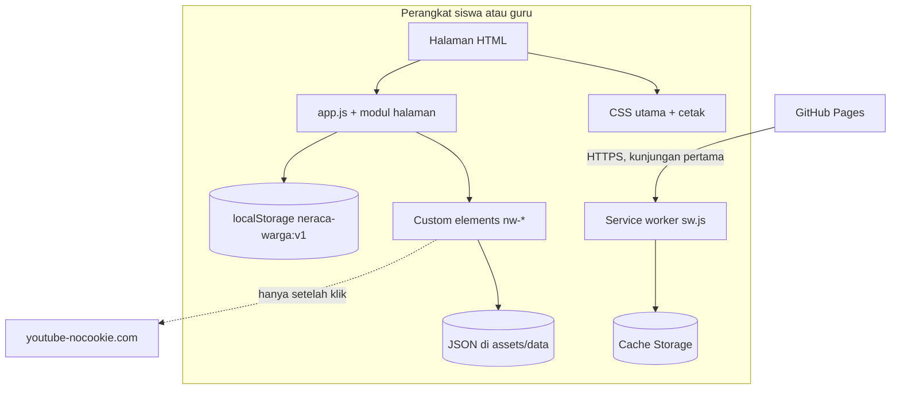

# Spesifikasi Teknis — Neraca Warga

## 1. Ringkasan arsitektur

Neraca Warga adalah **situs statis multi-halaman (MPA)** yang ditulis dengan HTML, CSS, dan JavaScript murni (*vanilla*), tanpa *build step* dan tanpa *framework*. Teks bacaan ditulis langsung di HTML. Data terstruktur (soal, permainan, pasal, glosarium) disimpan sebagai berkas JSON dan dirender oleh *custom elements*. Progres siswa disimpan di `localStorage` perangkat. *Service worker* membuat situs bisa dipakai luring. Situs di-*hosting* gratis di GitHub Pages.



## 2. Keputusan arsitektur (ADR)

| ID | Keputusan | Alasan | Konsekuensi |
| --- | --- | --- | --- |
| ADR-01 | HTML/CSS/JS murni, tanpa *framework*, tanpa *build* | Ringan untuk HP kelas bawah; dapat dipelihara agen tanpa memaksa YAN menjalankan perintah; panduan MWG berbasis *vanilla* | Kepala/kaki halaman diduplikasi di setiap HTML; konsistensinya dijaga skrip pemeriksa di CI |
| ADR-02 | MPA (satu berkas HTML per halaman) | Setiap halaman bisa dibuka dan di-*cache* sendiri; transisi antarhalaman memakai *cross-document view transitions*; *bfcache* bekerja | Status antarhalaman lewat `localStorage` |
| ADR-03 | Teks bacaan di HTML, data terstruktur di JSON | Teks terbaca tanpa JS, LCP cepat, mudah dicetak; data permainan/kuis cukup satu sumber | Widget memerlukan JS; tersedia pesan cadangan |
| ADR-04 | *Custom elements* (*light DOM*, awalan `nw-`) untuk widget | Siklus hidup jelas (`connectedCallback`/`disconnectedCallback`), dapat dipakai ulang, gaya global tetap berlaku | Kontrol di dalamnya tetap elemen asli (`button`, `input`) agar aksesibel |
| ADR-05 | `localStorage` dengan satu kunci berversi; tanpa data pribadi | Tanpa server; hak privasi siswa | Data hilang bila dihapus; tidak sinkron antarperangkat (memang disengaja) |
| ADR-06 | Service worker buatan sendiri (tanpa Workbox) | Tanpa *build*; logika kecil | Daftar *precache* harus diperbarui; diperiksa CI |
| ADR-07 | GitHub Pages di subjalur `/neraca-warga/` | Gratis; terhubung dengan alur GitHub Desktop YAN | **Semua URL relatif** (tanpa `/` di depan); tidak bisa mengatur *header* HTTP, sehingga CSP dipasang lewat `<meta>` |
| ADR-08 | Fitur inti hanya fitur *Baseline Widely available*; fitur lebih baru sebagai peningkatan progresif | Gawai siswa beragam | Ada tabel cadangan (§11); polifil hanya untuk Popover, di-*vendor* lokal dan dimuat bersyarat |

## 3. Struktur repositori

```text
neraca-warga/
├─ index.html  mulai.html  amati.html  selidiki.html
├─ kasus-1.html  kasus-2.html  kasus-3.html  kasus-4.html
├─ uji.html  renungkan.html  berkarya.html
├─ ruang-baca.html  baca-permasalahan.html  baca-upaya.html  baca-ham.html  baca-penegakan-hukum.html
├─ glosarium.html  guru.html  guru-penilaian.html  tentang.html  offline.html  404.html
├─ manifest.webmanifest
├─ sw.js                       ← di akar agar cakupannya seluruh situs
├─ .nojekyll                   ← matikan pemrosesan Jekyll di GitHub Pages
├─ assets/
│  ├─ css/   utama.css  guru.css  cetak.css
│  ├─ js/
│  │  ├─ tema-awal.js          ← skrip klasik kecil, memasang tema sebelum render
│  │  ├─ app.js                ← modul global setiap halaman
│  │  ├─ versi.js              ← export const VERSI = "0.1.0"
│  │  ├─ inti/   penyimpanan.js  pengumuman.js  gerak.js  data.js  progres.js  polifil.js  istilah.js
│  │  ├─ komponen/   nw-*.js   (lihat §6.2)
│  │  └─ halaman/    beranda.js  mulai.js  amati.js  …  (satu per halaman yang butuh widget)
│  ├─ data/  *.json            (lihat §7)
│  ├─ font/  plus-jakarta-sans-var-latin.woff2  OFL.txt
│  ├─ ikon/  sprite.svg  favicon.svg  ikon-192.png  ikon-512.png  ikon-maskable-512.png  apple-touch-icon.png  LISENSI-LUCIDE.txt
│  ├─ gambar/  *.svg  sampul-video.webp  og-neraca-warga.png
│  └─ vendor/  popover-polyfill.min.js   LISENSI-popover-polyfill.txt
├─ docs/                        ← dokumen perencanaan (paket ini) + laporan
│  ├─ 01-PRD.md … 07-PROMPT-AGEN.md
│  ├─ sumber/  modul-ajar.pdf  modul-ajar.txt  modul-ajar-tata-letak.txt
│  ├─ spek/    NW-xx.md         (spesifikasi rinci per fitur, Gerbang 2)
│  └─ laporan/ NW-xx-uji.md  verifikasi-konten.md
├─ tests/                       ← Playwright, skrip pemeriksa (tidak dipakai situs)
├─ .github/workflows/periksa.yml
├─ package.json                 ← hanya alat pengembangan & uji
├─ README.md  AGENTS.md  CLAUDE.md  CHANGELOG.md  LICENSE
└─ .gitignore                   ← node_modules/, test-results/, playwright-report/
```

## 4. Templat halaman

Setiap halaman memakai kerangka yang sama. Bagian `<header>` dan `<footer>` identik di semua halaman, kecuali `aria-current`.

```html
<!DOCTYPE html>
<html lang="id">
<head>
  <meta charset="utf-8">
  <meta name="viewport" content="width=device-width, initial-scale=1, viewport-fit=cover">
  <title>Amati: Apa yang sedang terjadi? | Neraca Warga</title>
  <meta name="description" content="Stasiun 2: amati data kasus kekerasan di satuan pendidikan dan video materi.">
  <meta name="color-scheme" content="light dark">
  <meta name="theme-color" content="#FBF8F3" media="(prefers-color-scheme: light)">
  <meta name="theme-color" content="#0F1720" media="(prefers-color-scheme: dark)">
  <meta http-equiv="Content-Security-Policy" content="default-src 'self'; script-src 'self'; style-src 'self'; img-src 'self' data:; font-src 'self'; connect-src 'self'; media-src 'self'; frame-src https://www.youtube-nocookie.com; object-src 'none'; base-uri 'self'; form-action 'self'; manifest-src 'self'; worker-src 'self'">
  <meta name="referrer" content="strict-origin-when-cross-origin">
  <link rel="manifest" href="manifest.webmanifest">
  <link rel="icon" href="assets/ikon/favicon.svg" type="image/svg+xml">
  <link rel="apple-touch-icon" href="assets/ikon/apple-touch-icon.png">
  <link rel="preload" href="assets/font/plus-jakarta-sans-var-latin.woff2" as="font" type="font/woff2" crossorigin>
  <script src="assets/js/tema-awal.js"></script>
  <link rel="stylesheet" href="assets/css/utama.css">
  <link rel="stylesheet" href="assets/css/cetak.css" media="print">
  <script type="module" src="assets/js/app.js"></script>
  <script type="module" src="assets/js/halaman/amati.js"></script>
</head>
<body data-halaman="amati" data-stasiun="2">
  <a class="lewati" href="#judul">Lewati ke konten utama</a>
  <header class="kepala"><!-- logo, nav aria-label="Utama", tombol Menu --></header>
  <main>
    <h1 id="judul" tabindex="-1">Amati: Apa yang sedang terjadi?</h1>
    <!-- isi -->
  </main>
  <footer class="kaki"><!-- Tentang, versi, lisensi --></footer>
  <div id="pengumuman" class="visually-hidden" role="status" aria-live="polite"></div>
</body>
</html>
```

Ketentuan:

- `lang="id"`. Kutipan berbahasa Inggris (misalnya *Stop, Take a breath, Observe, Proceed*) diberi `lang="en"`.
- Judul unik dengan pola `{Judul halaman} | Neraca Warga`.
- Tidak ada `<style>`, atribut `style`, `<script>` *inline*, atau `onclick` (CSP). Nilai dinamis dikirim ke CSS lewat `element.style.setProperty('--nilai', n)` dari JS.
- Jangan pernah menonaktifkan zoom (`user-scalable=no` dilarang).
- `<meta name="text-scale" content="scale">` **opsional**. Bila dipakai, akar dokumen sama sekali tidak boleh diberi `font-size` (MWG: `respect-os-text-scale`).

## 5. Arsitektur CSS

- Satu berkas `utama.css` tanpa `@import`. Lapisan dideklarasikan di baris pertama:

```css
@layer reset, token, dasar, tata-letak, komponen, halaman, utilitas;
```

- `token`: semua variabel dari 03-DESAIN-INTERAKSI §2 dan §6.
- `reset`: reset terarah per elemen, **tanpa** selektor `*` (MWG: `css` "No global resets").
- Selektor memakai `:where()` untuk *default* yang mudah ditimpa, `:has()` untuk gaya berdasarkan anak, dan *nesting* asli. Tanpa konvensi BEM.
- Properti logis (`margin-inline`, `padding-block`) kecuali posisi hak (kanan) dan kewajiban (kiri) yang sengaja fisik.
- *Container queries* untuk komponen; *media query* hanya untuk `pointer`, `prefers-*`, `forced-colors`, `print`.
- `guru.css` hanya dimuat di `guru*.html`. `cetak.css` dengan `media="print"`.
- Cadangan *pseudo-class* yang mungkin belum didukung memakai `:is()`/`:where()`, misalnya `[popover]:is(:popover-open, .\:popover-open)`.

## 6. Arsitektur JavaScript

### 6.1 Modul inti

| Berkas | Tanggung jawab |
| --- | --- |
| `tema-awal.js` | Skrip klasik < 1 KB di `<head>`: membaca preferensi tema dari `localStorage` dan memasang `data-tema` pada `<html>` sebelum render (tanpa kedip). Dibungkus `try/catch` |
| `app.js` | Dijalankan di setiap halaman: menu laci, sakelar tema, penanda stasiun, bilah bawah, status luring, pendaftaran *service worker*, notifikasi pembaruan, lencana, istilah glosarium, pemuat polifil |
| `inti/penyimpanan.js` | Pembungkus `localStorage` (§8): `baca(jalur)`, `tulis(jalur, nilai)`, `hapusSemua()`, `tersedia()`; cadangan di memori bila penyimpanan diblokir |
| `inti/pengumuman.js` | Satu *live region* `polite` per halaman: `umumkan(teks, {tunda})` dengan *debounce* dan jeda kecil agar tidak bertabrakan dengan pengumuman fokus; menahan pengumuman saat dialog modal terbuka |
| `inti/gerak.js` | `gerakDikurangi()` (`matchMedia`), `setelahAnimasi(el)` yang langsung selesai bila `el.getAnimations()` kosong |
| `inti/data.js` | `ambilData(nama)`: `fetch` JSON relatif dari `assets/data/`, validasi ringan, pesan galat ramah |
| `inti/progres.js` | Status stasiun, Ruang Baca, dan syarat lencana; memancarkan peristiwa `nw:lencana` |
| `inti/polifil.js` | `if (!Object.hasOwn(HTMLElement.prototype, "popover")) await import("../../vendor/popover-polyfill.min.js")`; dipanggil sebelum komponen yang memakai `popover` |
| `inti/istilah.js` | Mengubah `<span data-istilah="id">` pada teks menjadi tombol + `popover` definisi dari `glosarium.json` (hanya kemunculan pertama per halaman) |

### 6.2 *Custom elements*

Semua elemen *light DOM*, didaftarkan sekali (`customElements.define`), membersihkan *listener* lewat `AbortController` di `disconnectedCallback`, dan menampilkan pesan cadangan sebelum terdefinisi:

```css
:where(nw-hak-kewajiban, nw-kuis, nw-lkpd /* … */):not(:defined) > .nw-cadangan { display: block; }
```

| Elemen | Halaman | Data | Peristiwa keluar |
| --- | --- | --- | --- |
| `<nw-neraca>` | Beranda, Mulai, Ruang Baca 2 | — (SVG logo bernama) | — ; metode `miring(arah)`, `tambahToken(sisi)`, `seimbangkan()` |
| `<nw-cek-perasaan>` | Mulai | `perasaan.json` | — (tidak menyimpan apa pun) |
| `<nw-hak-kewajiban>` | Mulai, Mode Guru (`mode="proyektor"`) | `hak-kewajiban.json` | `nw:selesai` `{benar, total}` |
| `<nw-grafik-tebak>` | Amati | `jppi.json` | `nw:terungkap` `{tebakan}` |
| `<nw-grafik-batang>` | Amati, Ruang Baca 1 | `pisa.json` | — |
| `<nw-video>` | Amati | atribut `id-video`, `judul`, `sampul` | — |
| `<nw-simpan>` | Amati, Mulai, Renungkan, Berkarya | atribut `kunci` (jalur penyimpanan) | `nw:tersimpan`; menyimpan otomatis semua kontrol formulir di dalamnya kecuali yang bertanda `data-jangan-simpan` |
| `<nw-pasangan>` | Ruang Baca 2 | `pasangan.json` | `nw:selesai` |
| `<nw-peta-pasal>` | Ruang Baca 3, LKPD (`mode="pilih"`) | `pasal.json` | `nw:pasal-dipilih` |
| `<nw-siapa>` | Ruang Baca 4 | `skenario.json` | `nw:selesai` |
| `<nw-lkpd>` | `kasus-n.html` (atribut `kasus="n"`) | `lkpd.json`, `pasal.json` | `nw:selesai` |
| `<nw-kuis>` | Uji | `kuis.json` | `nw:selesai` `{skor, tp1, tp2}` |
| `<nw-napas>` | Renungkan | — | — |
| `<nw-salin>` | Berkarya, Ringkasan LKPD, Renungkan | atribut `untuk="#id"` atau teks anak | — |
| `<nw-timer>` | LKPD, Mode Guru | atribut `menit` | `nw:habis` |
| `<nw-alur-guru>` | Mode Guru | `alur-guru.json` | — |
| `<nw-roda>` | Mode Guru (P2) | — | — |
| `<nw-kalkulator-tp>` | Mode Guru | `rubrik.json` (parameter KKTP) | — ; **tidak menyimpan apa pun** |
| `<nw-glosarium>` | Glosarium | `glosarium.json` | — |

### 6.3 Konvensi kode

- ES2022+ modul (`type="module"`). Tanpa dependensi *runtime*.
- Pengait JS memakai atribut `data-*`, bukan kelas gaya.
- Teks dari siswa **selalu** ditampilkan dengan `textContent`. Tidak memakai `innerHTML` dengan data apa pun. Struktur dibangun dengan `<template>` + `cloneNode` atau `document.createElement` (MWG: `security` §1.2).
- Tugas berat (> 50 md) dipecah dengan `scheduler.yield()` berpenggantian `setTimeout` (MWG: `performance`, `break-up-long-tasks`). Dalam praktik, semua data kecil; jangan menambah kerja yang tidak perlu.
- Pembacaan dan penulisan *layout* dikelompokkan (hindari *layout thrashing*).
- Deteksi fitur, bukan *user-agent* (MWG: `privacy` §6).
- Penamaan berbahasa Indonesia untuk berkas, kelas CSS, kunci data, dan fungsi domain (`ambilData`, `tandaiSelesai`).

## 7. Skema data (`assets/data/*.json`)

Setiap berkas memuat `"versi"` dan `"sumber"`. Butir yang teksnya kutipan modul diberi `"asal": "modul"` agar diperiksa CI (§17). Butir yang belum disetujui YAN diberi `"status": "draf"` dan **tidak dirender** kecuali di Mode Guru dengan label "Draf". Di HTML, elemen yang isinya kutipan modul diberi atribut `data-asal="modul"`.

### 7.1 `hak-kewajiban.json`

```json
{
  "versi": 1,
  "sumber": "02-SPESIFIKASI-KONTEN §2.3",
  "butir": [
    { "id": "HK-01", "pernyataan": "Mengeluarkan pendapat", "jawaban": "hak",
      "dasar": "Kebebasan berserikat, berkumpul, dan mengeluarkan pendapat (Pasal 28E)" }
  ]
}
```

`jawaban` ∈ `hak` | `kewajiban` | `keduanya`. Validasi: 14 butir; 6 hak, 6 kewajiban, 2 keduanya.

### 7.2 `pasal.json`

```json
{
  "versi": 1,
  "pasal": [
    { "id": "28E", "label": "Pasal 28E", "bab": "XA", "jenis": "hak",
      "pokok": "Kebebasan memeluk agama, … serta kebebasan berserikat, berkumpul, dan mengeluarkan pendapat." },
    { "id": "27-1", "label": "Pasal 27 ayat (1)", "bab": "X", "jenis": "kewajiban",
      "pokok": "Kewajiban menjunjung hukum dan pemerintahan" }
  ]
}
```

Validasi: 10 pasal Bab XA (28A–28J) + 6 pasal di luar Bab XA + `24-2` (kekuasaan kehakiman, `jenis: "kelembagaan"`).

### 7.3 `kuis.json`

```json
{
  "versi": 1,
  "butir": [
    { "no": 1, "tp": 1,
      "soal": "Pelaksanaan hak dan kewajiban yang tidak seimbang dapat menyebabkan ....",
      "opsi": { "a": "…", "b": "…", "c": "pertikaian, konflik, permusuhan, dan kekerasan", "d": "…" },
      "kunci": "c",
      "pembahasan": "…",
      "rujukan": { "label": "Ruang Baca: pengantar", "href": "ruang-baca.html#pengantar" } }
  ]
}
```

Validasi: 10 butir; `tp` = 1 untuk no 1–5 dan 2 untuk no 6–10; kunci = C, A, D, B, C, A, D, B, A, C.

### 7.4 `lkpd.json`

```json
{
  "versi": 1,
  "kasus": [
    { "id": 1, "tema": "Kebebasan Berekspresi di Media Sosial",
      "halamanBukuSiswa": "49, 55-58, dan 60",
      "isianTambahanL2": null,
      "pihakDampak": ["korban", "pelaku", "kelas", "sekolah"],
      "pihakUpaya": ["pelajar"],
      "ruangBaca": ["baca-permasalahan.html#masalah-a", "baca-ham.html#peta-pasal"],
      "rambu": { "status": "draf", "hakTerganggu": "…", "kewajiban": "…", "pasal": ["28G", "28B", "28J"], "dampak": "…", "upaya": ["…"] } }
  ],
  "penuntun": { "L2": ["…", "…", "…"], "L3": ["…"], "L4": ["…"], "L5": ["…"], "L6": ["…"] },
  "cekMandiri": ["…"],
  "kerangkaPoster": ["Judul poster", "Masalah", "…"],
  "evaluasiProses": ["Ketepatan sumber yang digunakan", "…"]
}
```

`isianTambahanL2` berisi "Hak yang ingin dipenuhi siswa dan orang tua" (kasus 3) dan "Hak yang dituntut warga pembuka lahan" (kasus 4). Teks kasus **tidak** ada di JSON; teks itu ditulis di `kasus-n.html` agar terbaca tanpa JS dan bisa dicetak.

### 7.5 Berkas lain

| Berkas | Isi | Sumber konten |
| --- | --- | --- |
| `perasaan.json` | 6 pilihan perasaan + respons | 02 §2.2 |
| `jppi.json` | 6 tahun + jumlah kasus + sumber | 02 §3.2 |
| `pisa.json` | 7 bentuk + proporsi + catatan | 02 §3.6 |
| `pasangan.json` | 7 pasangan hak–kewajiban | 02 §4.2 |
| `skenario.json` | 10 situasi + pilihan + jawaban + alasan | 02 §4.4 |
| `glosarium.json` | 19 istilah | 02 §9 |
| `alur-guru.json` | 7 segmen + durasi + prinsip + kegiatan | 02 §10.1 |
| `rubrik.json` | Rubrik sikap, keterampilan, produk + parameter KKTP + interval | 02 §8.2, §10.3–10.5 |
| `lencana.json` | 8 lencana + syarat | 02 §12 |

## 8. Penyimpanan di perangkat

Satu kunci: **`neraca-warga:v1`** berisi objek JSON:

```json
{
  "versi": 1,
  "pengaturan": { "tema": "otomatis" },
  "progres": {
    "stasiun": { "mulai": "selesai", "amati": "sedang", "selidiki": "belum", "uji": "belum", "renungkan": "belum", "berkarya": "belum" },
    "ruangBaca": { "permasalahan": true, "upaya": false, "ham": false, "penegakanHukum": false },
    "terakhir": "amati.html"
  },
  "lencana": ["siap-belajar"],
  "mulai": { "hakKewajiban": { "terbaik": 12, "dimainkan": 2 }, "catatanPemantik": { "1": "…" } },
  "amati": { "tebakan2025": 400, "tanggapan": { "hak": ["rasa-aman"], "kewajiban": [], "teks": "…" } },
  "ruangBaca": { "pasanganSelesai": true, "pasalDibuka": ["28A", "28J"], "siapaSkor": 8 },
  "lkpd": { "1": { "langkah": "L4", "jawaban": { "L2": "…", "L3": "…", "L4": { "pasal": ["28G"], "alasan": { "28G": "…" } } }, "diperbarui": "2026-11-24T09:00:00+08:00" } },
  "kuis": { "terbaik": 90, "riwayat": [{ "tanggal": "2026-11-24", "skor": 80, "tp1": 80, "tp2": 80 }] },
  "renungkan": { "a": "…", "b": "…", "c": "…", "d": "…", "e": "…" },
  "berkarya": { "bentuk": "poster", "ceklis": [true, true, false, false, false, false] }
}
```

Aturan:

1. **Tidak pernah disimpan:** nama siswa/anggota kelompok, kelas, pilihan Cek Perasaan, masukan kalkulator nilai TP. Isian kelompok/kelas/nama di LKPD hanya hidup di memori untuk dicetak dan diberi `data-jangan-simpan`.
2. Riwayat kuis dibatasi 5 entri terakhir.
3. Semua akses dibungkus `try/catch` (mode privat, kuota penuh). Bila gagal, gunakan memori dan tampilkan pesan sekali per halaman.
4. **Hapus data** menghapus kunci `neraca-warga:v1` (pengaturan tema ikut terhapus) lalu memuat ulang halaman.
5. Perubahan skema menaikkan `versi` dan menambah fungsi migrasi. Data yang tidak dikenali dibuang dengan aman.
6. Penulisan memakai *debounce* ±800 md agar tidak membebani *main thread*.

## 9. Service worker dan manifest

### 9.1 `sw.js`

- `const VERSI = "0.1.0"` sama dengan `assets/js/versi.js`. Nama *cache*: `neraca-warga-${VERSI}`.
- **install:** `cache.addAll(ASET)`; daftar `ASET` memuat semua halaman, CSS, JS, JSON, font, ikon, gambar, `offline.html`. Diperiksa CI (§17).
- **activate:** hapus *cache* versi lama; `clients.claim()`.
- **fetch:**
  - Navigasi (`request.mode === "navigate"`): *network-first* dengan batas waktu 3 detik → *cache* → `offline.html` (MWG: `performance`, NetworkFirst untuk HTML).
  - Aset sesumber (CSS/JS/JSON/font/gambar): *cache-first* (berkas berversi lewat nama *cache*).
  - Lintas sumber (YouTube): tidak di-*cache*, tidak dicegat.
  - Hanya `GET`.
- **Pembaruan:** bila SW baru menunggu, `app.js` menampilkan notifikasi "Versi baru tersedia · Muat ulang". Tombol mengirim `postMessage({ jenis: "LEWATI_TUNGGU" })`, lalu halaman dimuat ulang saat `controllerchange`.
- Pendaftaran: `navigator.serviceWorker.register("sw.js", { scope: "./" })` setelah peristiwa `load`.

### 9.2 `manifest.webmanifest`

```json
{
  "id": "./",
  "name": "Neraca Warga — Media Ajar Hak dan Kewajiban",
  "short_name": "Neraca Warga",
  "description": "Media ajar interaktif Pendidikan Pancasila Kelas IX: Tantangan Pemenuhan Hak dan Kewajiban Warga Negara.",
  "lang": "id",
  "start_url": "./",
  "scope": "./",
  "display": "standalone",
  "background_color": "#FBF8F3",
  "theme_color": "#0E6B68",
  "categories": ["education"],
  "icons": [
    { "src": "assets/ikon/ikon-192.png", "sizes": "192x192", "type": "image/png" },
    { "src": "assets/ikon/ikon-512.png", "sizes": "512x512", "type": "image/png" },
    { "src": "assets/ikon/ikon-maskable-512.png", "sizes": "512x512", "type": "image/png", "purpose": "maskable" }
  ]
}
```

### 9.3 Tombol pasang

Tombol **Pasang di perangkat** disembunyikan secara bawaan. Tombol muncul hanya bila `navigator.install` tersedia atau peristiwa `beforeinstallprompt` tertangkap. Peristiwa itu bersifat sekali pakai dan dibuang sebelum menunggu pilihan pengguna. Jangan menampilkan langkah pemasangan per peramban (MWG: `install-web-app`).

## 10. Integrasi video

- Elemen `<nw-video>` menampilkan sampul **lokal** (`assets/gambar/sampul-video.webp`, dengan `width`/`height`), tombol putar, dan keterangan "Video dimuat dari YouTube".
- Tidak ada permintaan ke pihak ketiga sebelum tombol diketuk (MWG: `privacy` §4, pola *façade*).
- Setelah diketuk: `<iframe src="https://www.youtube-nocookie.com/embed/uG8lYTLmUBk?autoplay=1" title="Video materi Tantangan Pemenuhan Hak dan Kewajiban Warga Negara" allow="autoplay; encrypted-media; picture-in-picture; fullscreen" referrerpolicy="strict-origin-when-cross-origin">`, dibuat dengan `createElement`, lalu fokus dipindah ke *iframe*.
- Saat luring (`navigator.onLine === false`), tombol diganti pesan luring dan ringkasan teks tetap tampil.

## 11. Kebijakan dukungan peramban

**Kebijakan:** fitur inti hanya memakai fitur *Baseline Widely available*. Fitur *Newly available* atau *Limited* hanya boleh sebagai peningkatan progresif: konten dan fungsi tetap jalan tanpanya. Kode cadangan buatan sendiri maksimal ±20 baris per fitur. Tidak ada dependensi dari CDN (situs harus luring). Polifil hanya untuk Popover, di-*vendor* di `assets/vendor/` dan dimuat bersyarat.

Status di bawah ini mengikuti panduan MWG (repo `GoogleChrome/modern-web-guidance`, *commit* `2b4aa13`, 23 November 2026). Agen wajib memeriksa ulang status lewat `retrieve` saat membangun.

| Fitur | Status | Peran di situs | Cadangan |
| --- | --- | --- | --- |
| `<dialog>` + `showModal()` | Widely (sejak 2022-03) | Inti: dialog pasal, konfirmasi hapus, menu laci, lencana | — |
| `<details>`/`<summary>` | Widely (sejak 2020-01) | Inti: akordeon, tabel data alternatif | — |
| `:has()` | Widely (sejak 2023-12) | Inti: gaya *chip*, kartu | — |
| *Container queries* (ukuran) | Widely (sejak 2023-02) | Inti: tata letak komponen | — |
| `:user-valid`/`:user-invalid` | Widely (sejak 2023-11) | Inti: validasi LKPD | — |
| `linear()` *easing* | Widely (sejak 2023-12) | Kurva pegas | Deklarasi kata kunci sebelumnya |
| `color-scheme` | Widely (sejak 2022-02) | Tema | — |
| Clipboard `writeText` | Widely (sejak 2020-03) | Tombol salin | Pesan "tekan lama untuk menyalin" |
| Intersection Observer | Widely (sejak 2019-03) | Cadangan pemicu grafik | — |
| `light-dark()` | Newly (sejak 2024-05) | Token warna | Pola cadangan panduan `dark-mode` |
| Popover API | Newly (sejak 2025-01) | Definisi istilah, notifikasi | Polifil lokal bersyarat; gaya `:is(:popover-open, .\:popover-open)` |
| *Mutually exclusive* `<details name>` | Newly (sejak 2024-09) | Akordeon eksklusif | Akordeon tidak eksklusif |
| `@starting-style`, `transition-behavior` | Newly (sejak 2024-08) | Animasi masuk/keluar | Muncul/hilang tanpa animasi |
| `@property` | Newly (sejak 2024-07) | Cincin progres halus | Cincin berubah tanpa interpolasi |
| `field-sizing: content` | Newly (sejak 2026-06) | Kolom isian membesar sendiri | `rows="4"` + `resize: vertical` |
| *Scroll-driven animations* | Newly (sejak 2026-10) | Dekoratif: batang tumbuh, bilah progres baca | Tidak ada (dekoratif); dijaga `@supports` |
| *View transitions* (satu dokumen) | Newly (sejak 2025-10) | Tidak dipakai untuk fungsi | — |
| *Cross-document view transitions* | Limited (tanpa Firefox) | Transisi antarstasiun | Navigasi biasa |
| Navigation API | Newly (sejak 2026-01) | Menentukan arah transisi | Arah dari atribut tautan (`data-arah`) atau *cross-fade* |
| *Invoker commands* (`command`, `commandfor`) | Newly (sejak 2025-12) | **Tidak dipakai** | Gunakan `showModal()` dan `popovertarget` |
| *Anchor positioning* | Belum merata | **Tidak dipakai** | Popover diletakkan tengah/lembar bawah |
| *Interest invokers*, `popover="hint"` | Limited | **Tidak dipakai** | Ketuk untuk membuka |
| `ariaNotify()` | Newly (sejak 2026-09) | **Tidak dipakai** | *Live region* |
| *Scroll-state container queries* | Limited | Kepala tersembunyi saat menggulir | Kepala tetap tampil |
| `beforeinstallprompt` / `navigator.install()` | Limited / belum didukung | Tombol pasang | Tombol disembunyikan |
| `<meta name="text-scale">` | Limited | Opsional | — |

## 12. Alur wajib *Modern Web Guidance*

Untuk setiap fitur yang menyentuh HTML/CSS/JS sisi klien, agen **wajib**:

1. **Cari** panduan dengan kueri bahasa Inggris 2–5 kata untuk satu kemampuan:
   `npx -y modern-web-guidance@latest search "<kueri>" --skill-version 2026_11_16-268fb9ea`
2. **Ambil** panduan yang cocok beserta panduan disiplin umumnya (`html`, `css`, `accessibility`, `performance`, …):
   `npx -y modern-web-guidance@latest retrieve "<id>,<id>"`
3. **Terapkan dan cocokkan** kode dengan aturan panduan, termasuk cadangan sesuai §11.
4. **Ungkapkan** dalam laporan serah terima lewat bagian `### Modern Web Guidance`: satu butir per ID panduan yang benar-benar dipakai, berisi pilihan yang tidak lazim beserta kutipan pendek aturan yang relevan. Bila tidak ada panduan yang dipakai, tulis satu kalimat tentang panduan yang diperiksa dan alasannya.

Bila tidak ada akses jaringan ke npm, baca berkas panduan langsung dari repositori `GoogleChrome/modern-web-guidance` (`skills/modern-web-guidance/guides/<kategori>/<id>.md`). Agen menjalankan perintah ini sendiri. **YAN tidak pernah diminta menjalankan perintah.**

**Peta panduan per area**

| Area | ID panduan |
| --- | --- |
| Struktur, semantik, aksesibilitas dasar | `html`, `accessibility`, `accessible-generated-content`, `respect-os-text-scale` |
| CSS & tata letak | `css`, `css-layout`, `responsive-design`, `fluid-scaling`, `size-aware-styling`, `child-state-based-styling`, `individual-transform-properties`, `animate-to-intrinsic-sizes` |
| Warna, tema, tipografi | `color`, `dark-mode`, `dark-mode-toggle`, `browser-ui-theming`, `typography`, `improve-text-layout-and-legibility`, `visually-stable-font-fallbacks` |
| Pengalaman pengguna | `natural-interactions`, `form-factor-adaptation`, `content-first-noise-reduction` |
| Gerak & transisi | `motion`, `physics-based-easing`, `animate-element-entry-exit`, `animate-to-from-top-layer`, `cross-document-transitions`, `consistent-cross-document-transitions`, `directional-navigation-transitions`, `scroll-entry-exit-effects`, `scroll-progress-indicator` |
| Komponen | `dialog`, `light-dismiss-a-dialog`, `prevent-page-scroll-under-modal-dialog`, `declarative-dialog-popover-control` (bagian cadangan), `accordion`, `card`, `navbar`, `navigation-drawer`, `persistent-toast-notifications`, `progress`, `progress-ring`, `copy-button`, `icons`, `responsive-table`, `checkbox`, `slider`, `interest-triggered-tooltips` (bagian *toggletip*) |
| Formulir | `forms`, `validate-input-after-interaction`, `required-field-feedback`, `form-fields-automatically-fit-contents`, `accessible-error-announcement` |
| *Web components* | `custom-elements`, `accessible-web-components`, `web-components` |
| Kinerja | `performance`, `optimize-image-priority`, `deliver-optimized-decorative-images`, `lazy-load-video-and-audio`, `break-up-long-tasks`, `identify-inp-causes`, `improve-next-page-load-performance` |
| PWA | `install-web-app` |
| Privasi & keamanan | `privacy`, `security`, `sanitize-untrusted-html` |
| JavaScript | `js` |
| Gestur seret (P2) | `drag-and-drop` (pola *pointer capture*, `Escape`, alternatif keyboard) |

## 13. Anggaran kinerja

| Ukuran | Batas |
| --- | --- |
| Berat halaman kunjungan pertama (terkompresi, tanpa video) | ≤ 250 KB |
| HTML per halaman | ≤ 30 KB |
| `utama.css` terkompresi | ≤ 25 KB |
| JS per halaman (app + komponen) terkompresi | ≤ 40 KB |
| Font WOFF2 | ≤ 90 KB (satu berkas variabel, di-*preload*) |
| Gambar per halaman | ≤ 60 KB; SVG ilustrasi ≤ 30 KB per berkas |
| Total *precache* | ≤ 2 MB |
| LCP / INP / CLS (lab, HP menengah 4G) | ≤ 2,5 dtk / ≤ 200 md / ≤ 0,1 |
| Lighthouse seluler | Performance, Accessibility, Best Practices ≥ 90 |

Ketentuan: elemen LCP berupa teks/SVG *inline* di HTML (tanpa *lazy*); gambar di bawah lipatan memakai `loading="lazy"` + `width`/`height`; skrip `type="module"`; tanpa `@import`; `content-visibility` **tidak** dipakai karena halaman kecil (MWG: `performance`).

## 14. Ketentuan aksesibilitas (ringkas)

Target WCAG 2.2 AA. Ringkasan wajib dari MWG `accessibility`, `forms`, `motion`:

- Satu `<h1>` per halaman; hierarki judul berurutan; *landmark* lengkap; tautan lewati menuju `<h1 id="judul" tabindex="-1">`.
- Elemen asli lebih dulu (`button`, `a`, `input`, `dialog`, `details`). ARIA hanya bila tidak ada padanan asli, dan perilakunya harus sesuai perannya.
- Fokus terlihat (`:focus-visible`, kontras ≥ 3:1, `outline-offset`). Tanpa `tabindex` positif.
- Fokus berpindah ke awal konten baru yang muncul karena tindakan pengguna (langkah LKPD, hasil kuis), dan kembali ke pemicu saat dialog ditutup (otomatis oleh `<dialog>`).
- Satu *live region* `polite` per halaman; pengumuman di-*debounce*; tidak mengumumkan "memuat…".
- Semua kolom punya `<label for>`; petunjuk di atas kolom, dihubungkan `aria-describedby`; placeholder bukan label.
- Grafik punya `<figcaption>` dan tabel data alternatif; video punya ringkasan teks; ilustrasi informatif punya teks alternatif.
- Gestur geser/seret selalu punya tombol alternatif; `touch-action: pan-y` (bukan `none`) pada kartu yang bisa digeser.
- `prefers-reduced-motion` dihormati per kasus; tidak ada animasi otomatis > 5 dtk tanpa jeda; tidak ada kedip > 3/dtk.
- Uji manual: keyboard saja, TalkBack (Android/Chrome), NVDA (Windows/Firefox), zoom 200%, lebar 320 px, *forced colors*.

## 15. Privasi dan keamanan

- **Tanpa** analitik, cookie, akun, formulir yang mengirim data, atau skrip pihak ketiga.
- Satu-satunya sumber pihak ketiga adalah *iframe* `youtube-nocookie.com`, dan hanya setelah diketuk.
- CSP lewat `<meta>` (§4); `frame-ancestors` dan `Permissions-Policy` tidak bisa diatur di GitHub Pages (keterbatasan yang diterima). HTTPS dipaksa oleh GitHub Pages.
- Data di perangkat mengikuti §8. Halaman Tentang menjelaskan secara jelas apa yang disimpan, di mana, dan cara menghapusnya (MWG: `privacy` §2, transparansi).
- Tidak ada konten HTML dari luar yang disisipkan. Jika kelak perlu, wajib memakai `setHTML()`/Sanitizer sesuai `sanitize-untrusted-html`.

## 16. Hosting dan rilis

1. Repositori publik `Y4N-D/neraca-warga` (syarat GitHub Pages pada paket gratis).
2. GitHub → *Settings* → *Pages* → *Source*: **Deploy from a branch** → *Branch*: `main`, folder `/ (root)` → *Save*. Dilakukan sekali oleh YAN lewat antarmuka web setelah NW-01 (ada `index.html`).
3. Alamat: `https://y4n-d.github.io/neraca-warga/`.
4. `.nojekyll` di akar; `404.html` khusus dipakai otomatis oleh GitHub Pages.
5. Setiap rilis: naikkan `VERSI` di `assets/js/versi.js` dan `sw.js`, perbarui `CHANGELOG.md`, beri *tag* `v0.x.y` lewat GitHub Desktop (opsional).

## 17. Pemeriksaan otomatis (CI)

`.github/workflows/periksa.yml` berjalan pada setiap *push* dan *pull request* ke `main`. YAN cukup melihat tanda ✓/✗ di GitHub; agen yang memperbaiki bila gagal.

| Langkah | Alat | Gagal bila |
| --- | --- | --- |
| Validasi HTML | `html-validate` | Ada galat HTML |
| Konsistensi kerangka | `tests/periksa-kerangka.mjs` | `<header>`/`<footer>` berbeda antarhalaman (selain `aria-current`); judul halaman ganda; ada `style=`/`<style>`/skrip *inline* |
| Data | `tests/periksa-data.mjs` (Ajv + aturan §7) | Skema tidak cocok; jumlah butir/kunci/TP salah |
| Kesetiaan konten | `tests/periksa-modul.mjs` | Teks di dalam elemen ber-`data-asal="modul"` dan medan JSON ber-`"asal": "modul"` tidak ditemukan di `docs/sumber/modul-ajar.txt` (urutan baca) maupun `docs/sumber/modul-ajar-tata-letak.txt`. Bandingkan setelah dinormalisasi: buang baris kepala/kaki halaman PDF, huruf kecil, lalu sisakan hanya huruf dan angka (tahan terhadap spasi, tanda kutip, dan tanda hubung yang rusak saat ekstraksi PDF). Potongan yang memang rusak di ekstraksi (misalnya tabel dua kolom) dicatat di `tests/pengecualian-modul.json` beserta alasannya |
| *Precache* | `tests/periksa-sw.mjs` | Ada berkas situs yang tidak tercantum di `ASET`, atau sebaliknya |
| Uji asap & aksesibilitas | Playwright + `@axe-core/playwright` (Chromium) | Galat konsol; halaman gagal dimuat; pelanggaran axe *serious/critical*; skenario kunci gagal (06 §4) |
| Anggaran (P2) | Lighthouse CI | Melewati §13 |

Alat-alat ini hanya ada di `package.json` sebagai `devDependencies` dan tidak dimuat oleh situs.
