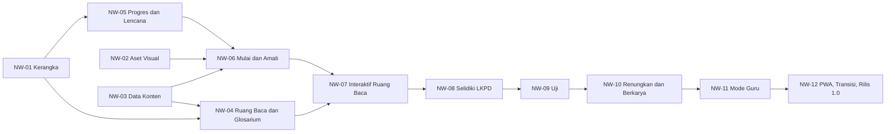

# Rencana Kerja — Neraca Warga

## 1. Cara kerja: gerbang per fitur

Pekerjaan dipecah menjadi fitur **NW-01 s.d. NW-12**. Awalan *NW* (Neraca Warga) sengaja berbeda dari F-xx dan JS-xx milik Ruang Setara agar tidak tertukar. Setiap fitur melewati gerbang berikut:

| Tahap | Yang dikerjakan agen | Agen berhenti? | Yang diserahkan |
| --- | --- | --- | --- |
| **Gerbang 1 — Rencana** | Membaca dokumen terkait, lalu menulis bagian *Rencana* di `docs/spek/NW-xx.md`: lingkup, berkas yang disentuh, pendekatan, panduan MWG yang akan diambil, risiko, pertanyaan untuk YAN | Ya, menunggu persetujuan YAN | ZIP kecil berisi dokumen yang berubah + pesan *commit* |
| **Gerbang 2 — Spesifikasi** | Melengkapi `docs/spek/NW-xx.md`: kerangka *markup*, keadaan komponen, data yang dipakai, skenario uji, hasil `search`/`retrieve` MWG | Ya, menunggu persetujuan YAN | ZIP kecil + pesan *commit* |
| **Bangun → Uji** | Membuat kode, menjalankan semua pemeriksaan (06-RENCANA-UJI), menulis `docs/laporan/NW-xx-uji.md` | — | — |
| **Serah terima** | Mengikuti *Cara Menyerahkan Hasil* (AGENTS.md §6) | Ya | ZIP berisi hanya berkas baru/berubah, daftar berkas berubah, tangkapan layar, pesan *commit*, langkah GitHub Desktop |

Fitur berukuran **S** boleh menggabungkan Gerbang 1 dan 2 bila YAN setuju.

## 2. Peta fitur dan ketergantungan

## 3. Jalur paralel (tiga sesi Claude)

Agar tiga sesi bisa bekerja bersamaan tanpa saling menimpa berkas, **setiap folder dimiliki satu jalur**:

| Jalur | Fokus | Fitur | Folder milik jalur |
| --- | --- | --- | --- |
| **A — Mesin** | HTML, CSS, JS, *service worker*, uji | NW-01, NW-04 s.d. NW-12 | `*.html`, `assets/css/`, `assets/js/`, `assets/vendor/`, `sw.js`, `manifest.webmanifest`, `tests/` (kecuali milik B), `.github/`, `package.json` |
| **B — Konten** | Data JSON, pemeriksa konten, laporan verifikasi | NW-03 (lalu pemeliharaan konten) | `assets/data/`, `tests/skema/`, `tests/periksa-data.mjs`, `tests/periksa-modul.mjs`, `docs/laporan/verifikasi-konten.md` |
| **C — Visual** | Logo, ikon, ilustrasi, font | NW-02 (lalu ilustrasi tambahan) | `assets/gambar/`, `assets/ikon/`, `assets/font/`, `docs/aset/` |

Aturan koordinasi:

1. Kontrak bersama adalah **skema data** (04 §7), **nama berkas aset** (§4 NW-02), dan **token desain** (03 §2). Perubahan kontrak harus disetujui YAN dan dicatat di dokumen terkait.
2. Jalur A tidak mengubah isi JSON; bila menemukan kesalahan konten, A mencatatnya untuk B. Jalur B tidak mengubah HTML; teks bacaan di HTML disalin A dari 02-SPESIFIKASI-KONTEN.
3. Setiap sesi dimulai dari **ZIP repositori terbaru** yang dilampirkan YAN. Bila ZIP tampak bukan versi terbaru (misalnya tidak memuat hasil fitur yang sudah di-*commit*), agen bertanya dulu.
4. YAN meng-*commit* hasil satu jalur dalam satu waktu. Karena foldernya terpisah, urutan *commit* antarjalur tidak menimbulkan konflik.

## 4. Rincian fitur

Ukuran: **S** ≈ 1 sesi, **M** ≈ 2 sesi, **L** ≈ 3 sesi atau lebih.

### NW-01 — Kerangka & fondasi · Jalur A · M

- **Tujuan:** semua halaman ada, terhubung, aksesibel, dan bertema.
- **Cakupan:** struktur repositori (04 §3); 22 halaman HTML dengan templat (04 §4), judul unik, `<h1>`, *landmark*, tautan lewati, kepala/kaki identik, penanda stasiun, bilah bawah; `utama.css` (lapisan, token terang/gelap, tipografi, tombol, kartu, tata letak, fokus, target sentuh, *forced colors*); `tema-awal.js` + tema otomatis; `app.js` (menu laci `<dialog>`, `aria-current`, sebelumnya/berikutnya); `inti/penyimpanan.js`, `inti/pengumuman.js`, `inti/gerak.js`; isi lengkap `tentang.html` dari 02 §1 dan §13; `offline.html`, `404.html`; `.nojekyll`, `.gitignore`, `package.json`, CI dasar (validasi HTML, pemeriksa kerangka, uji asap Playwright + axe).
- **Kriteria terima:**
  - Semua 22 halaman terbuka tanpa galat konsol, baik lokal maupun di GitHub Pages (URL relatif).
  - `html-validate` 0 galat; axe 0 pelanggaran *serious/critical* di semua halaman.
  - Keyboard: tautan lewati memindahkan fokus ke `<h1>`; menu laci terbuka/tertutup dengan `Esc`, fokus kembali ke tombol Menu.
  - Lebar 320 px tanpa gulir horizontal; zoom 200% tanpa konten terpotong.
  - Tema gelap mengikuti sistem; tidak ada kedip tema saat dimuat.
  - CI hijau.
- **MWG utama:** `html`, `accessibility`, `css`, `css-layout`, `typography`, `color`, `dark-mode`, `form-factor-adaptation`, `content-first-noise-reduction`, `navigation-drawer`, `natural-interactions`.

### NW-02 — Aset visual dasar · Jalur C · M

- **Cakupan:** logo neraca SVG dengan bagian bernama (`#lengan`, `#piring-kiri`, `#piring-kanan`); `favicon.svg`; ikon aplikasi 192, 512, *maskable* 512, `apple-touch-icon`; `sprite.svg` (±30 ikon Lucide + ikon hak, kewajiban, neraca); font Plus Jakarta Sans variabel *subset* Latin WOFF2 + OFL; ilustrasi 6 stasiun, 4 kasus, 404, dan sampul video lokal (ilustrasi orisinal dengan ikon putar, bukan gambar dari YouTube); 6 ikon wajah Cek Perasaan; `docs/aset/README.md` (daftar berkas, ukuran, lisensi, saran teks alternatif).
- **Kriteria terima:** semua SVG valid dan dioptimalkan (SVGO); ilustrasi ≤ 30 KB, font ≤ 90 KB; warna memakai token atau `currentColor` dan terbaca di tema terang/gelap; tanpa adegan kekerasan, foto, atau gambar Buku Siswa; lisensi tercatat.
- **MWG utama:** `icons`, `deliver-optimized-decorative-images`, `optimize-image-priority`, `visually-stable-font-fallbacks`, `accessibility` §6.

### NW-03 — Data konten · Jalur B · M

- **Cakupan:** semua berkas `assets/data/*.json` (04 §7) dari 02-SPESIFIKASI-KONTEN; skema JSON di `tests/skema/`; `tests/periksa-data.mjs`; `tests/periksa-modul.mjs`; `docs/laporan/verifikasi-konten.md` yang mendaftar setiap butir `[DRAF]`, `[VERIFIKASI-PASAL]`, `[DIISI-YAN]` beserta lokasinya dan kotak centang untuk keputusan YAN.
- **Kriteria terima:** pemeriksa data lulus (jumlah butir, komposisi, kunci, pemetaan TP); semua medan `"asal": "modul"` cocok dengan `docs/sumber/modul-ajar.txt`; tidak ada konten di luar 02; butir berstatus `draf` tercantum di laporan verifikasi.
- **MWG:** tidak ada (bukan kode UI), tetapi patuhi skema 04 §7.

### NW-04 — Ruang Baca & Glosarium · Jalur A · M

- **Cakupan:** `ruang-baca.html` + 4 halaman `baca-*.html` (teks 02 §4, `data-asal="modul"`, `data-istilah`); `glosarium.html` + `<nw-glosarium>` (cari, 19 istilah); `inti/istilah.js` (definisi lewat `popover`, polifil bersyarat); tombol *Tandai sudah dibaca*; bilah progres baca (peningkatan); tabel responsif; gaya cetak bacaan.
- **Kriteria terima:** pemeriksa kesetiaan konten lulus; pencarian glosarium menyaring dan mengumumkan jumlah hasil dengan *debounce*; definisi istilah terbuka dengan ketuk/`Enter`, tertutup dengan `Esc`, fokus kembali; tabel bertumpuk rapi di 320 px; status *sudah dibaca* tersimpan.
- **MWG utama:** `html`, `accessibility`, `responsive-table`, `interest-triggered-tooltips`, `content-first-noise-reduction`, `scroll-progress-indicator`, `typography`, `improve-text-layout-and-legibility`.

### NW-05 — Progres, lencana, notifikasi · Jalur A · S

- **Cakupan:** `inti/progres.js`; kartu status stasiun dan tombol *Lanjutkan* di Beranda; notifikasi lencana (`popover="manual"`) dan daftar lencana; dialog **Hapus data**; pesan bila penyimpanan tidak tersedia; `inti/polifil.js`.
- **Kriteria terima:** progres bertahan setelah muat ulang; *Hapus data* mengosongkan progres; uji memastikan tidak ada nama di `localStorage`; notifikasi tidak muncul saat dialog modal terbuka; situs tetap berfungsi saat `localStorage` diblokir (disimulasikan).
- **MWG utama:** `persistent-toast-notifications`, `dialog`, `privacy`, `accessibility` §8.

### NW-06 — Stasiun Mulai & Amati · Jalur A (+ ilustrasi C) · L

- **Cakupan:** `<nw-neraca>`, `<nw-cek-perasaan>`, `<nw-hak-kewajiban>`, tujuan belajar ramah siswa, pemantik + `<nw-simpan>`; `<nw-grafik-tebak>`, `<nw-grafik-batang>`, `<nw-video>`, tanggapan awal (*chip*), kotak *Butuh bantuan?*; interaksi IM-02 s.d. IM-09.
- **Kriteria terima:**
  - Permainan: 14 butir, urutan tombol **Kewajiban | Keduanya | Hak**, umpan balik memuat dasar, neraca seimbang di akhir, *Main lagi* mengacak urutan; dapat dimainkan dengan keyboard saja; hasil diumumkan.
  - Cek Perasaan tidak menulis apa pun ke penyimpanan (diuji).
  - Grafik: pesan tebakan sesuai ambang 02 §3.2; tabel data alternatif tersedia.
  - Video: **tidak ada permintaan jaringan ke luar** sebelum tombol putar diketuk (diuji dengan Playwright); pesan luring tampil saat luring.
  - Gerak berkurang: tidak ada gerak spasial, keadaan akhir benar.
- **MWG utama:** `physics-based-easing`, `individual-transform-properties`, `animate-element-entry-exit`, `motion`, `slider`, `checkbox`, `scroll-entry-exit-effects`, `lazy-load-video-and-audio`, `privacy`, `custom-elements`, `accessible-web-components`.

### NW-07 — Interaktif Ruang Baca · Jalur A · L

- **Cakupan:** Kartu Masalah, `<nw-pasangan>`, `<nw-peta-pasal mode="jelajah">`, Pohon Peradilan, `<nw-siapa>`; interaksi IM-10 s.d. IM-14.
- **Kriteria terima:** Pasangan Seimbang 7 pasangan, petunjuk muncul setelah 2 kali keliru pada hak yang sama; Peta Pasal memuat 17 entri (28A–28J, 27 ayat (1)–(3), 30 ayat (1), 31 ayat (1)–(2), 24 ayat (2)), pencarian menyaring, dialog menampilkan pokok pengaturan dan jenis; Siapa yang Menangani? 10 situasi dalam 2 babak; semua dapat dipakai dengan keyboard dan pembaca layar.
- **MWG utama:** `dialog`, `animate-to-from-top-layer`, `accordion`, `animate-to-intrinsic-sizes`, `html` (`<search>`), `physics-based-easing`.

### NW-08 — Selidiki: LKPD digital · Jalur A · L

- **Cakupan:** `selidiki.html` (kartu 4 kasus, peran); `kasus-1…4.html` (teks kasus 02 §5.5 dengan `data-asal="modul"`); `<nw-lkpd>` langkah L0–L10, penuntun bertahap, `<nw-peta-pasal mode="pilih">`, simpan otomatis, cek mandiri, kerangka poster, evaluasi proses, ringkasan cetak/salin; `<nw-timer>` (P1); interaksi IM-16 s.d. IM-18.
- **Kriteria terima:**
  - Teks kasus, pertanyaan, dan halaman Buku Siswa sama persis dengan modul.
  - Isian L0 (kelompok/kelas/nama) **tidak** tersimpan (diuji); isian lain tersimpan dan pulih setelah muat ulang.
  - L6 memerlukan minimal 2 upaya; pesan muncul setelah interaksi, bukan sebelum.
  - Fokus berpindah ke judul langkah saat berganti langkah.
  - Ringkasan tercetak rapi di A4 (diperiksa lewat PDF dari Playwright); tombol salin berfungsi.
- **MWG utama:** `forms`, `validate-input-after-interaction`, `required-field-feedback`, `form-fields-automatically-fit-contents`, `accessible-error-announcement`, `progress`, `copy-button`, `html` §6.

### NW-09 — Uji: kuis · Jalur A · M

- **Cakupan:** `<nw-kuis>`; satu soal per layar; umpan balik + pembahasan; skor total dan per TP; rekomendasi tanpa duplikat; riwayat 5 terakhir; interaksi IM-19, IM-20.
- **Kriteria terima:** soal, opsi, dan kunci sama persis dengan modul; nilai TP 1 dari butir 1–5 dan TP 2 dari butir 6–10 (20 per butir); hasil diumumkan dan fokus pindah ke judul hasil; tidak ada label "mencapai KKTP"; gerak berkurang dihormati.
- **MWG utama:** `motion`, `physics-based-easing`, `progress`, `accessibility` §8, `forms`.

### NW-10 — Renungkan & Berkarya · Jalur A · M

- **Cakupan:** simpulan; `<nw-napas>` (STOP); refleksi a–e + Catatan Tempel + salin/cetak; halaman Berkarya (tugas, tabel rubrik, bank data dengan `<nw-salin>`, ceklis); interaksi IM-22 s.d. IM-24.
- **Kriteria terima:** napas mulai hanya setelah diketuk, dapat dijeda, 3 siklus dengan durasi 4–2–6 detik, mode gerak berkurang hanya teks + hitung mundur; refleksi dan ceklis tersimpan; tombol salin memberi umpan balik yang juga dibacakan; lencana terkait terpicu.
- **MWG utama:** `motion`, `copy-button`, `forms`, `responsive-table`.

### NW-11 — Mode Guru · Jalur A · L

- **Cakupan:** `guru.html`: `<nw-alur-guru>` + `<nw-timer>` per segmen, tampilan proyektor, pintasan keyboard, *ice breaking* proyektor (`<nw-hak-kewajiban mode="proyektor">`), pemantik, kelompok–LKPD–peran, `<nw-roda>` (P2). `guru-penilaian.html`: rubrik sikap & keterampilan, `<nw-kalkulator-tp>`, rambu jawaban (hanya butir disetujui), versi cetak LKPD kosong 1–4 dan soal post-test (tanpa/dengan kunci).
- **Kriteria terima:** durasi segmen sesuai modul (15, 10, 5, 25, 35, 10, 20 menit); timer bisa dimulai, dijeda, diulang, dan dilanjutkan dengan keyboard; kalkulator menghasilkan nilai tepat untuk kasus A–C (02 §10.5: 78/100, 53/43, 22/35) beserta kategori, tindak lanjut, dan aturan pengayaan; kalkulator tidak menyimpan apa pun; hasil cetak rapi.
- **MWG utama:** `progress-ring`, `motion`, `forms`, `responsive-table`, `accessibility`.

### NW-12 — PWA, transisi & rilis 1.0 · Jalur A · M

- **Cakupan:** `sw.js` (04 §9), `offline.html`, manifest final, tombol pasang, notifikasi pembaruan; transisi antardokumen berarah (IM-25); `tests/periksa-sw.mjs`; audit anggaran kinerja; audit aksesibilitas manual; uji perangkat; verifikasi konten akhir oleh YAN; README, CHANGELOG, `v1.0.0`.
- **Kriteria terima:** uji mode pesawat lulus untuk semua halaman setelah satu kunjungan; Lighthouse seluler ≥ 90 untuk Performance, Accessibility, dan Best Practices di Beranda, Mulai, `kasus-1`, Uji; checklist 02 §14 lengkap; semua butir `draf` sudah diputuskan; YAN menandatangani laporan rilis.
- **MWG utama:** `install-web-app`, `performance`, `improve-next-page-load-performance`, `cross-document-transitions`, `consistent-cross-document-transitions`, `directional-navigation-transitions`.

## 5. Tonggak rilis

| Versi | Isi | Setelah fitur |
| --- | --- | --- |
| v0.1 | Kerangka tampil di GitHub Pages | NW-01, NW-02, NW-03 |
| v0.3 | Ruang Baca, glosarium, progres | NW-04, NW-05 |
| v0.6 | Alur siswa lengkap (6 stasiun) | NW-06 s.d. NW-10 |
| v0.8 | Mode Guru | NW-11 |
| v1.0 | Luring, transisi, audit, verifikasi konten | NW-12 |

Uji coba kelas terbatas (06 §7) sebaiknya dilakukan pada v0.8 agar masukan siswa masih bisa diterapkan sebelum v1.0.

## 6. *Definition of Done* (berlaku untuk setiap fitur)

- [ ] Kriteria terima fitur terpenuhi dan dibuktikan di `docs/laporan/NW-xx-uji.md`.
- [ ] CI hijau (HTML, kerangka, data, konten, uji asap, axe).
- [ ] Diuji dengan keyboard saja, gerak berkurang, tema gelap, lebar 320 px.
- [ ] Tidak ada konten baru di luar 02-SPESIFIKASI-KONTEN; butir baru ditandai dan dilaporkan.
- [ ] Tidak ada rujukan pasal baru tanpa persetujuan YAN.
- [ ] Tidak ada dependensi *runtime*, CDN, atau skrip pihak ketiga baru.
- [ ] Daftar *precache* diperbarui bila ada berkas baru (mulai NW-12).
- [ ] Laporan serah terima memuat bagian `### Modern Web Guidance`.
- [ ] Dokumen yang terdampak (`docs/`) ikut diperbarui.

## 7. Pengelolaan perubahan

- Perubahan lingkup atau prioritas dicatat di riwayat versi PRD dan memerlukan persetujuan YAN.
- Temuan masalah dicatat di `docs/laporan/catatan-masalah.md` (tanggal, halaman, langkah mengulang, status).
- Butir konten yang disetujui YAN diubah statusnya dari `draf` menjadi `disetujui` di JSON dan dicentang di `docs/laporan/verifikasi-konten.md`.
